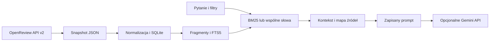

# Architektura

Program działa lokalnie w Pythonie, bez zależności uruchomieniowych.
SQLite przechowuje dane i indeks FTS5; CLI łączy kolejne etapy.

## Dane

Snapshot zachowuje notatki API, schematy formularzy i informacje o pobraniu.
Publikacja jest osobnym rekordem; abstrakt i każda oficjalna recenzja są
oddzielnymi źródłami. Recenzję rozpoznaje dokładna mapa invitation–submission,
z kontrolą forum i replyto. Komentarze, rebuttale, decyzje i metarecenzje
pozostają w snapshotcie, lecz nie trafiają do indeksu jako recenzje.

Wartości ocen i nazwy pól pozostają oryginalne. Skale ICLR i NeurIPS
pozostają rozdzielone. Brakujące dane nie są uzupełniane zerami ani tekstem.

## Wyszukiwanie

Fragment ma jedno źródło, pole, zakres znaków i identyfikator zależny od treści.
Domyślne dzielenie to 180 słów z overlap=30. BM25 i baseline wspólnych słów
korzystają z tej samej tokenizacji i listy stopwords. Filtry konferencji
i rodzaju źródła działają przed top-k. Ranking zawiera różne źródła,
wybrane według najlepszego fragmentu każdego z nich.

SQLite pasuje do niewielkiego zbioru, działa na CPU i pozwala odtworzyć indeks
bez dodatkowego serwera. Wyszukiwanie leksykalne jest łatwe do
porównania z baseline, ale ma ograniczenia przy parafrazach i syntezie wielu prac.

## Kontekst i odpowiedź

Do odnalezionej recenzji można dołączyć abstrakt właściwej publikacji.
Ma oznaczenie `added_by_relation` i nie zwiększa wyniku retrieval.
Etykiety cytowań odnoszą się do tekstu po ograniczeniu objętości kontekstu.
Prompt, kontekst i mapa źródeł są zapisywane przed wywołaniem modelu.

Tryb `--provider none` kończy się zapisanym pakietem. Opcjonalny adapter
Gemini odczytuje ten sam prompt, zachowuje odpowiedź i sprawdza etykiety.
Sam poprawny identyfikator cytowania nie potwierdza poparcia twierdzenia.

## Ewaluacja i odtwarzanie

Benchmark zapisuje pytania, source ID, uzasadnienia i fragmenty dowodowe.
Zamrożenie obejmuje hashe tych plików i fingerprint indeksu. Hit@5 liczy
różne notatki źródłowe; pytania bez danych są poza mianownikiem.

Manifest wskazuje snapshot przez względną ścieżkę i SHA-256. Import jest
idempotentny, a odbudowa w nowym folderze musi dać ten sam indeks i rankingi.
Skrypty pakowania dołączają wybrane dane i przykłady, pomijając sekrety oraz cache.
